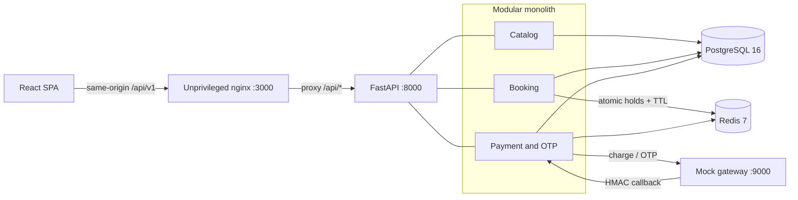

<div align="center">

# CinemaSeat

**A movie-ticket booking system built around one non-negotiable invariant: a seat is never sold twice.**

[](#production-deployment)
[](https://github.com/sakawatkabir13/cinemaseat/actions/workflows/ci.yml)
[](api/pyproject.toml)
[](api/app/main.py)
[](web/package.json)
[](docker-compose.yml)
[](docker-compose.yml)
[](#license)

[Quick start](#quick-start) · [Architecture](#architecture) · [API reference](#api-reference) · [Verification](#verification) · [System Design](SYSTEM_DESIGN.md) · [Decisions](DECISIONS.md)

</div>

---

## Table of contents

- [Why this project exists](#why-this-project-exists)
- [What the system guarantees](#what-the-system-guarantees)
- [Quick start](#quick-start)
- [Booking flow](#booking-flow)
- [Architecture](#architecture)
- [API reference](#api-reference)
- [Payment callbacks and failure handling](#payment-callbacks-and-failure-handling)
- [Configuration](#configuration)
- [Verification](#verification)
- [Production deployment](#production-deployment)
- [Known limitations](#known-limitations)
- [Repository map](#repository-map)
- [Technology stack](#technology-stack)
- [Documentation](#documentation)

## Why this project exists

Ticket inventory is a classic distributed-systems trap: dozens of buyers can click "select seat" on the same 30 seconds of showtime at the same instant, and the payment provider on the other end will happily deliver its confirmation twice. CinemaSeat exists to answer one question concretely rather than theoretically — **how do you guarantee exactly-once seat ownership when the lease store, the system of record, and the payment gateway can each fail or duplicate independently?**

Redis provides fast, atomic, self-expiring seat holds. PostgreSQL supplies the durable booking and payment constraints that make double-selling structurally impossible, not just unlikely. FastAPI coordinates an asynchronous, at-least-once payment flow against an intentionally unreliable mock gateway, and a React frontend carries the customer from showtime selection to a confirmed ticket.

## What the system guarantees

| Invariant | Enforcement |
|---|---|
| At most one live hold per showtime and seat | Redis `SET ... NX EX` |
| Only the hold owner can extend or release a hold | Token-checked Redis Lua scripts |
| At most one confirmed booking per showtime and seat | PostgreSQL partial unique index |
| At most one payment and booking per hold | PostgreSQL unique constraints |
| A gateway event changes state at most once | `payment_events.event_id` primary key plus a payment-row lock |
| Duplicate payment requests are safe | Existing payment is returned for the same hold |
| Abandoned seats become available automatically | Native Redis key expiry |

These guarantees deliberately favor correctness over maximum availability. A partial failure can temporarily leave a seat unavailable until its hold expires, but it cannot create a second confirmed booking. The full reasoning behind that trade-off is in [DECISIONS.md](DECISIONS.md).

## Quick start

### Prerequisite

- Docker with Compose v2

### Run the complete stack

```bash
git clone https://github.com/sakawatkabir13/cinemaseat.git
cd cinemaseat
docker compose up --build
```

No `.env` file or manual database setup is required. On startup, the API applies all Alembic migrations and runs an idempotent seed operation.

Once the containers are healthy:

| Service | URL |
|---|---|
| Customer web app | [https://cinemaseat.cuetinsights.dev/](https://cinemaseat.cuetinsights.dev/) |
| GitHub repository | [https://github.com/sakawatkabir13/cinemaseat](https://github.com/sakawatkabir13/cinemaseat) |
| Drive link | [https://drive.google.com/file/d/1TBJ423DjF6Lj9HJuRYmkfU65WI1d7mO7/view](https://drive.google.com/file/d/1TBJ423DjF6Lj9HJuRYmkfU65WI1d7mO7/view) |

The seeded catalog contains three movies, two theatres, four showtimes, and 80 seats. Showtime dates are generated relative to the day the seed first runs.

Stop the stack without deleting its data:

```bash
docker compose down
```

Use `docker compose down -v` only when you intentionally want to erase the local PostgreSQL and Redis volumes.

## Booking flow

1. The browser loads movies and showtimes from `GET /movies`.
2. It polls a selected showtime's seat map every four seconds.
3. `POST /showtimes/{id}/holds` atomically claims one seat in Redis and records the hold in PostgreSQL.
4. The UI displays the server-provided expiry time and submits `POST /pay` before it elapses.
5. `/pay` commits a local payment intent, returns `202 Accepted`, and dispatches the gateway charge in background work.
6. The mock gateway sends an HMAC-signed, at-least-once callback.
7. The callback transaction deduplicates the event and creates the booking. The UI polls payment status once per second until it reaches a terminal state.

The frontend sends deterministic mock-gateway mode for its demo checkout. API clients can exercise the gateway's other documented chaos modes with `X-Mock-Mode` and `X-Mock-Force`; only those two headers are forwarded.

> For the full sequence diagram — including every retry, race, and failure path — see [SYSTEM_DESIGN.md](SYSTEM_DESIGN.md#booking-and-payment-sequence).

## Architecture



The backend is a modular monolith: catalog, booking, and payment have separate routers, schemas, and services, but share one deployment and one transactional database boundary. The web image compiles the Vite application, serves it from a non-root nginx process, and proxies `/api/*` to FastAPI. This keeps the Compose browser flow same-origin.

For the deeper system view — component responsibilities, data model, and every state machine — see **[SYSTEM_DESIGN.md](SYSTEM_DESIGN.md)**. For the rationale, alternatives, failure modes, and evolution triggers behind each choice, see **[DECISIONS.md](DECISIONS.md)**. A problem-by-problem mapping of the supplied unreliable gateway is in **[GATEWAY_RESILIENCE.md](GATEWAY_RESILIENCE.md)**.

## API reference

All application endpoints except `/health` are rooted at `/api/v1`.

| Method | Path | Purpose | Success |
|---|---|---|---|
| `GET` | `/movies` | List movies with their showtimes | `200` |
| `GET` | `/movies/{movie_id}/showtimes` | List one movie's showtimes | `200` |
| `GET` | `/showtimes/{showtime_id}/seats` | Read live `AVAILABLE`, `HELD`, or `BOOKED` seat state | `200` |
| `POST` | `/showtimes/{showtime_id}/holds` | Hold one seat for the configured TTL | `201` |
| `POST` | `/pay` | Persist a payment intent and queue gateway dispatch | `202` |
| `GET` | `/payments/{payment_id}` | Poll payment and booking status | `200` |
| `GET` | `/bookings/{reference}` | Fetch a booking record by reference | `200` |
| `POST` | `/payments/callback` | Receive signed gateway payment events | `200` |
| `POST` | `/otp/send` | Queue the optional OTP demonstration | `202` |
| `POST` | `/otp/verify` | Verify a demo OTP with the gateway | `200` |
| `POST` | `/otp/callback` | Receive signed OTP delivery events | `200` |
| `GET` | `/health` | Report API-process liveness | `200` |

<details>
<summary><strong>Minimal API walkthrough</strong> (click to expand)</summary>

First, inspect a seeded showtime:

```bash
curl http://localhost:8000/api/v1/showtimes/1/seats
```

Hold an available seat:

```bash
curl --request POST http://localhost:8000/api/v1/showtimes/1/holds \
  --header 'Content-Type: application/json' \
  --data '{"seat_id":1,"customer_email":"buyer@example.com"}'
```

A successful response includes the ownership token and authoritative expiry:

```json
{
  "hold_id": "4cc83550-904a-4c27-aef0-0c3cdd6c78a0",
  "showtime_id": 1,
  "seat_id": 1,
  "status": "HELD",
  "expires_at": "2026-08-08T10:00:30Z",
  "ttl_seconds": 30
}
```

Competing buyers receive `409 Conflict`. Submit the returned `hold_id` for payment:

```bash
curl --request POST http://localhost:8000/api/v1/pay \
  --header 'Content-Type: application/json' \
  --header 'X-Mock-Mode: deterministic' \
  --data '{"hold_id":"4cc83550-904a-4c27-aef0-0c3cdd6c78a0","currency":"BDT"}'
```

`POST /pay` returns immediately after persisting the intent:

```json
{
  "payment_id": "69d9c075-ab21-45cf-a6fc-a42a42323d12",
  "booking_ref": "CS-149D88AA1B054D2E",
  "status": "ACCEPTED",
  "poll_url": "/api/v1/payments/69d9c075-ab21-45cf-a6fc-a42a42323d12"
}
```

Poll `GET {poll_url}` while the status is `PENDING` or `INITIATING`. A successful terminal response has `status: "SUCCEEDED"` and `booking_confirmed: true`.

</details>

### Payment outcomes

| Status | Meaning | Client action |
|---|---|---|
| `PENDING` | Intent exists; gateway completion is pending | Keep polling |
| `INITIATING` | A charge request is in flight | Keep polling |
| `SUCCEEDED` | Payment and durable booking both succeeded | Show the ticket |
| `FAILED` | Gateway reported failure | Start over |
| `INITIATION_FAILED` | Bounded charge attempts were exhausted | Start over or escalate |
| `SUCCEEDED_NO_HOLD` | Money arrived after hold ownership was lost | Refund required |
| `CONFLICT_REFUND_REQUIRED` | Another durable booking won an exceptional race | Refund required |
| `REFUNDED` | Revenue flag reversed and booking cancelled | Seat is sellable again |

`SUCCEEDED_NO_HOLD` and `CONFLICT_REFUND_REQUIRED` are explicit reconciliation states. The current project records them for operator action; it does not call a gateway refund endpoint automatically.

## Payment callbacks and failure handling

- Callback HMAC-SHA256 is verified against the exact raw body using `GATEWAY_SECRET` before parsing or mutation. Missing or invalid signatures receive `401`.
- A valid event is located by stable `booking_ref`, so the callback-before-charge-response race is supported.
- `payment_events.event_id` is the durable deduplication key. Duplicate delivery returns `200` without repeating booking or revenue state changes.
- Valid but malformed, unknown-reference, or non-actionable events return `200` because replay cannot repair them. Transient internal failures return `503`, allowing the gateway to retry.
- Charge transport failures use bounded retries with the same `Idempotency-Key` (`booking_ref`).
- A startup/periodic sweep retries stale `PENDING` and `INITIATING` payments after an API crash.
- `/health` intentionally checks only process liveness. Database, Redis, and gateway readiness should be monitored separately in production.

The implementation was also exercised manually against the supplied gateway container's failure controls:

| Gateway behavior | CinemaSeat response |
|---|---|
| Delayed success callback | `/pay` remains fast; the callback later confirms one booking |
| Forced payment failure | Payment becomes `FAILED` and only the matching hold token is released |
| Duplicate callback | The first event changes state; replays are acknowledged without duplicate booking or revenue |
| Charge timeout | Three bounded attempts reuse one idempotency key, then record `INITIATION_FAILED` |
| Callback before `/charge` response | Stable `booking_ref` resolves the already-persisted payment |
| API crash before dispatch completes | The stale-payment sweep redispatches after restart |
| PostgreSQL outage during callback | The API returns `503`; a later gateway retry completes after recovery |
| Valid refund | Payment becomes `REFUNDED`, booking becomes `CANCELLED`, and the seat can be sold again |

The optional OTP endpoints are fully connected to the mock gateway but deliberately do **not** authorize or gate a booking. See [ADR-005](DECISIONS.md#adr-005-keep-otp-separate-from-booking-authorization) for the reasoning.

## Configuration

Copy `.env.example` to `.env` only when overriding the Compose defaults.

| Variable | Compose default | Notes |
|---|---|---|
| `POSTGRES_DB` | `cinemaseat` | Local database name |
| `POSTGRES_USER` | `cinemaseat` | Local database user |
| `POSTGRES_PASSWORD` | `cinemaseat` | Development-only password |
| `DATABASE_URL` | `postgresql+asyncpg://cinemaseat:cinemaseat@db:5432/cinemaseat` | SQLAlchemy async connection URL |
| `REDIS_URL` | `redis://redis:6379/0` | Hold and OTP state |
| `HOLD_TTL_SECONDS` | `30` | Must be positive; make it longer than the expected checkout interaction |
| `GATEWAY_URL` | `http://gateway:9000` | Server-to-server gateway base URL |
| `GATEWAY_CALLBACK_URL` | `http://api:8000/api/v1/payments/callback` | URL supplied with a charge |
| `GATEWAY_OTP_CALLBACK_URL` | `http://api:8000/api/v1/otp/callback` | URL supplied with an OTP request |
| `GATEWAY_SECRET` | `z2p-2026-secret` | Shared HMAC secret; replace outside local development |
| `GATEWAY_REQUEST_TIMEOUT_SECONDS` | `3` | Timeout for one gateway attempt |
| `GATEWAY_MAX_ATTEMPTS` | `3` | Bounded charge attempts, from 1 to 10 |
| `VITE_API_BASE_URL` | `/api/v1` | Build-time browser API base; Compose uses the nginx proxy |
| `API_IMAGE` | `cinemaseat-api:local` | Override with a published API image |
| `WEB_IMAGE` | `cinemaseat-web:local` | Override with a published web image |

Vite variables are compiled into the browser bundle. Rebuild the web image after changing `VITE_API_BASE_URL`. When running Vite directly, the source fallback is `http://localhost:8000/api/v1`; use `npm run dev -- --port 3000` from `web/` to match the API's current development CORS allowlist.

## Verification

### Automated API tests

Run the same test target used by CI:

```bash
docker build --target test -t cinemaseat-api-test ./api
docker run --rm cinemaseat-api-test
```

The seven tests cover:

- 100 simultaneous hold attempts producing one `201` and 99 `409` responses;
- sequential and concurrent duplicate callback delivery;
- exactly one event, booking, and revenue transition;
- refund cancellation and subsequent re-holding of the seat;
- rejection of missing or invalid callback signatures;
- automatic seat availability after hold expiry; and
- a fast, dependency-independent liveness endpoint.

These fast API tests use SQLite plus a lock-protected Redis test double. They are complemented by the saved real-PostgreSQL/Redis/HTTP runs below.

### Measured Compose-stack scenarios

The repository includes the runners and raw evidence from host-generated runs against the real Compose services on 8 August 2026.

| Scenario | Measured result | Evidence |
|---|---|---|
| 100 buyers contend for one seat | 1 hold, 99 conflicts, 0 other responses, 0 oversells; 688 ms burst | [runner](loadtest/scenario_a.sh) · [raw output](loadtest/results/scenario_a_raw.txt) |
| One hold is abandoned with a 5-second TTL | Seat returned to `AVAILABLE`, a second buyer held it, payment succeeded, final state `BOOKED` | [runner](loadtest/scenario_b.sh) · [raw output](loadtest/results/scenario_b_raw.txt) |
| Two fresh callbacks share one new event ID | One `confirmed`, one `duplicate`, one event, one booking, one revenue flag | [runner](loadtest/fresh_duplicate_callback.sh) · [raw output](loadtest/results/fresh_duplicate_callback_raw.txt) |
| 100 simultaneous replays of an existing callback | 100/100 HTTP 200; p50 0.458 s, p95 0.563 s, max 0.636 s versus a 5 s gateway timeout | [runner](loadtest/callback_latency.sh) · [raw output](loadtest/results/callback_latency_raw.txt) |

The latency result is a measured load point, not a breakpoint or capacity claim. The shell runners require Bash and common CLI tools such as `curl`, `jq`, `openssl`, and `xargs`; some also inspect the running database through Docker Compose.

CI independently validates the Compose file, builds and tests the API image, audits production web dependencies, and builds the frontend.

## Production deployment

On pushes to `main`, the CD workflow tests the API, publishes commit-addressed API and web images to GHCR, and updates an EC2 Compose host over SSH.

Configure a GitHub `production` environment with:

- secrets: `EC2_HOST`, `EC2_USER`, `EC2_SSH_KEY`, `EC2_DEPLOY_PATH`;
- variable: `DEPLOY_URL`.

The target host needs Docker Compose, this repository's `docker-compose.yml`, production environment values, access to GHCR, and an appropriate ingress configuration. For a serious deployment, place TLS and a load balancer in front of the web tier, use managed PostgreSQL and Redis, rotate the gateway secret, and keep the API/web containers stateless.

## Known limitations

- Payment dispatch and recovery run inside the API process rather than through a transactional outbox and durable worker queue.
- Expired Redis keys restore live availability, but no reconciler changes abandoned PostgreSQL hold rows from `HELD` to `EXPIRED` unless a later payment attempt touches that hold.
- Refund-required outcomes are recorded but not automatically sent to a gateway refund API.
- OTP is a gateway integration demo, not identity verification or booking authorization.
- Callback recovery ultimately depends on the gateway's finite retry window; there is no durable local webhook inbox.
- Signed callbacks are recorded but not yet checked for amount/currency equality with the local payment intent, and conflicting out-of-order terminal events need stricter transition rules.
- Authentication, authorization, rate limiting, production observability, and Scenario C breakpoint testing are out of scope.
- The repository defines an EC2 deployment workflow, but no public production URL is committed here.

## Repository map

```text
.
├── api/
│   ├── app/catalog/       # movies, showtimes, live seat map
│   ├── app/booking/       # atomic holds and booking lookup
│   ├── app/payment/       # payment dispatch, callbacks, recovery, OTP
│   ├── migrations/        # Alembic schema history
│   └── tests/             # concurrency and lifecycle tests
├── docs/                  # supplied problem and gateway references
├── loadtest/              # reproducible scenarios and saved raw results
├── web/                   # Vite, React, TypeScript, TanStack Query, nginx
├── .github/workflows/     # CI and EC2-oriented CD
├── docker-compose.yml
├── .env.example
├── SYSTEM_DESIGN.md       # component, data-model, and sequence diagrams
├── DECISIONS.md           # architecture decision records
└── GATEWAY_RESILIENCE.md  # gateway failures, defenses, evidence, and gaps
```

## Technology stack

- **Web:** React 19, TypeScript, Vite, TanStack Query/Router, Tailwind CSS, shadcn/ui
- **API:** Python 3.12, FastAPI, SQLAlchemy asyncio, Alembic, HTTPX
- **State:** PostgreSQL 16 and Redis 7 with append-only persistence
- **Runtime:** Docker Compose and unprivileged nginx
- **Delivery:** GitHub Actions, GHCR, and EC2 over SSH

## Documentation

| Document | Covers |
|---|---|
| **[SYSTEM_DESIGN.md](SYSTEM_DESIGN.md)** | Component diagram, data model, hold/payment/booking state machines, full sequence diagrams for the happy path and every race condition |
| **[DECISIONS.md](DECISIONS.md)** | Eight ADRs — what was chosen, why, how it fails, and when to revisit it |
| **[GATEWAY_RESILIENCE.md](GATEWAY_RESILIENCE.md)** | A problem-by-problem mapping of the supplied unreliable gateway to CinemaSeat's defenses |

---

<div align="center">

Built as a concurrency-focused systems demonstration · [Report an issue](https://github.com/sakawatkabir13/cinemaseat/issues)

</div>
