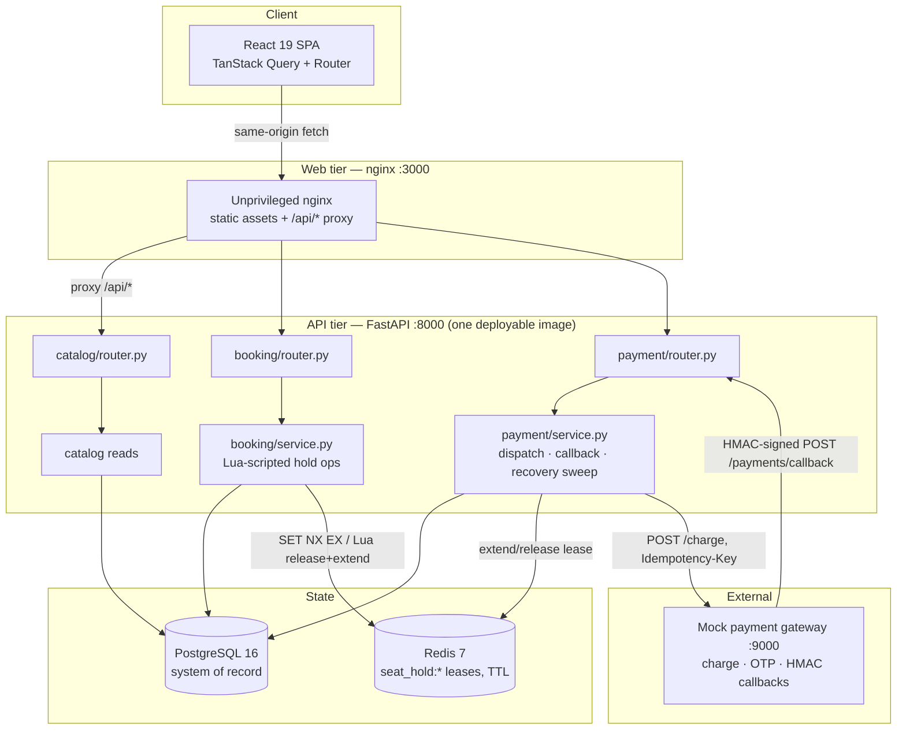
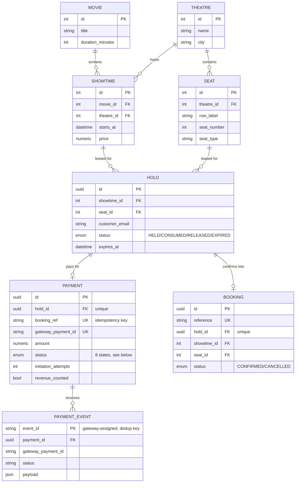
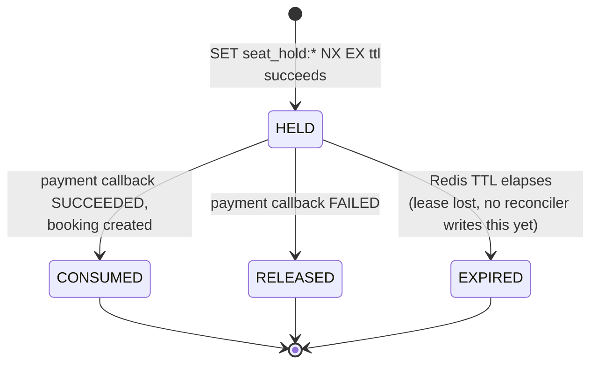
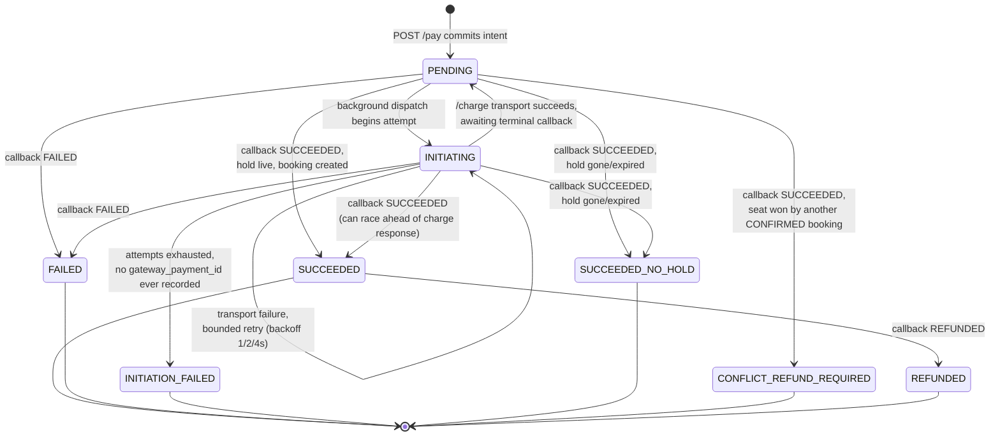
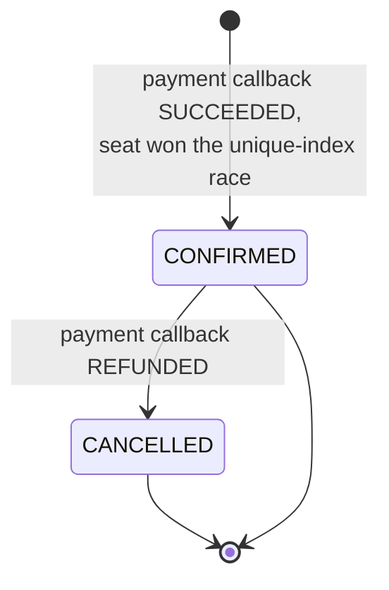
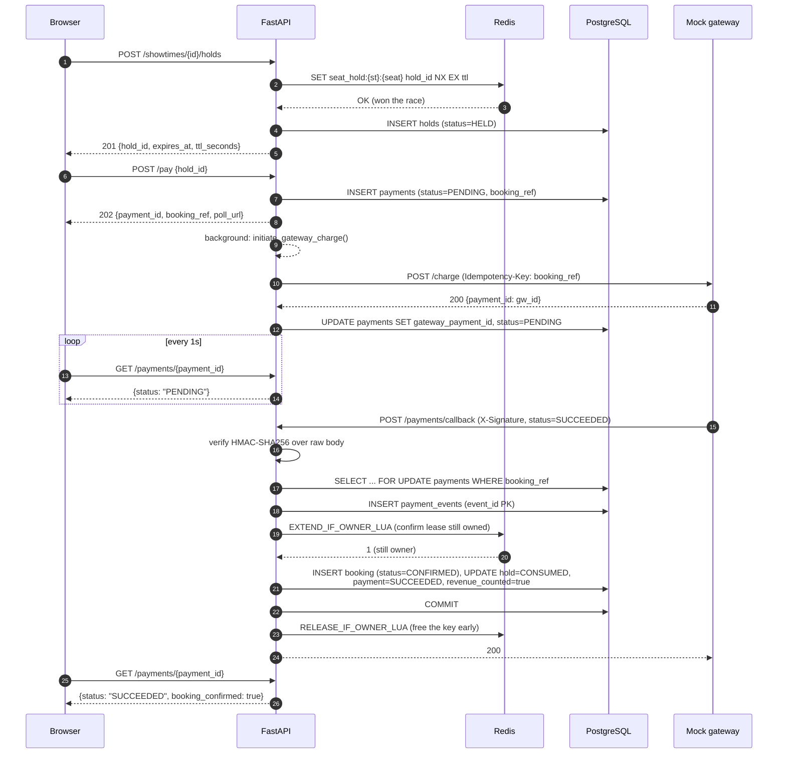
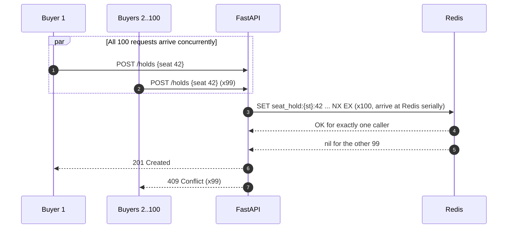
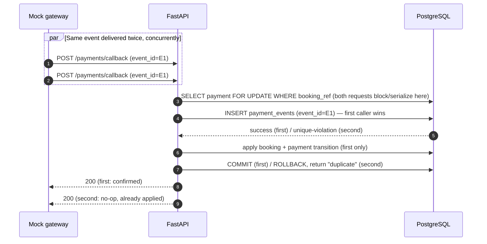
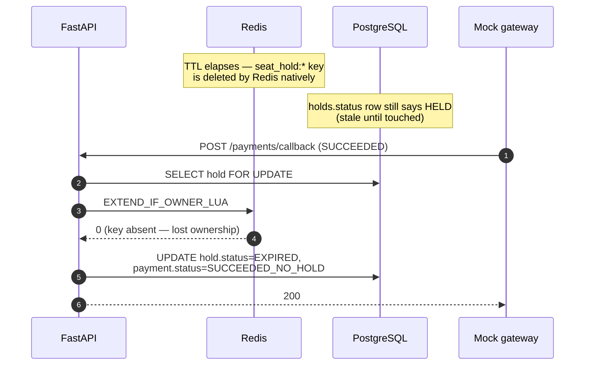

# System Design

This document is the diagram-first companion to [DECISIONS.md](DECISIONS.md). Where DECISIONS.md argues *why*, this document shows *what* — component boundaries, the data model, every state machine, and the exact sequence of calls for the happy path and each documented race condition.

## Contents

- [Component diagram](#component-diagram)
- [Data model](#data-model)
- [State machines](#state-machines)
  - [Hold lifecycle](#hold-lifecycle)
  - [Payment lifecycle](#payment-lifecycle)
  - [Booking lifecycle](#booking-lifecycle)
- [Booking and payment sequence](#booking-and-payment-sequence)
  - [Happy path](#happy-path)
  - [Race: 100 buyers, one seat](#race-100-buyers-one-seat)
  - [Race: duplicate callback delivery](#race-duplicate-callback-delivery)
  - [Race: callback arrives before the charge response](#race-callback-arrives-before-the-charge-response)
  - [Failure: API crash between dispatch and callback](#failure-api-crash-between-dispatch-and-callback)
  - [Failure: hold expires before payment succeeds](#failure-hold-expires-before-payment-succeeds)
- [Request/response shapes](#requestresponse-shapes)

## Component diagram



**Ownership boundaries** (also see [ADR-002](DECISIONS.md#adr-002-keep-one-modular-fastapi-deployment)):

| Module | Owns | Never touches |
|---|---|---|
| `catalog` | Movies, showtimes, live seat-map composition | Redis writes, gateway calls |
| `booking` | Hold creation, Lua-scripted release/extend, `hold_key()` naming | Payment or gateway state |
| `payment` | Charge dispatch, callback verification/dedup, recovery sweep, OTP, booking creation on success | Direct seat-map reads (delegates to catalog's composition rule) |

## Data model



**Constraints that do the actual correctness work** (not just documentation — enforced in `api/app/models.py`):

- `bookings`: a **partial unique index** on `(showtime_id, seat_id) WHERE status = 'CONFIRMED'` — the final no-oversell barrier.
- `bookings.hold_id` and `payments.hold_id`: unique — one payment and one booking per hold, ever.
- `payment_events.event_id`: primary key, gateway-assigned — the durable callback deduplication key.
- `holds`: `CHECK (expires_at > created_at)`.

## State machines

### Hold lifecycle



The Redis key is authoritative for whether a hold is *currently* live; the PostgreSQL `holds.status` column is the audit trail. These can disagree briefly — see [ADR-001](DECISIONS.md#adr-001-use-redis-leases-with-postgresql-as-the-durable-booking-backstop) and [Known limitations](README.md#known-limitations).

### Payment lifecycle



`SUCCEEDED`, `FAILED`, `SUCCEEDED_NO_HOLD`, `CONFLICT_REFUND_REQUIRED`, and `REFUNDED` are terminal — the recovery sweep only touches `PENDING`/`INITIATING` (`RECOVERABLE_PAYMENT_STATUSES` in `payment/service.py`).

### Booking lifecycle



Because the uniqueness index is scoped to `status = 'CONFIRMED'`, a `CANCELLED` row no longer blocks a fresh hold/booking for the same `(showtime_id, seat_id)`.

## Booking and payment sequence

### Happy path



### Race: 100 buyers, one seat



`SET ... NX` is atomic at the Redis single-thread execution layer, so exactly one of 100 concurrent `POST /holds` wins regardless of arrival order. Measured: 1×`201`, 99×`409`, 0 oversells, 688 ms burst — see [loadtest/scenario_a.sh](loadtest/scenario_a.sh).

### Race: duplicate callback delivery



The row lock on `payments` plus the `event_id` primary key make the database — not an application-level check — the single source of truth for "have I seen this event." Measured: 100 concurrent replays of an existing event, 100/100 `HTTP 200`, p95 0.563 s against a 5 s gateway timeout — see [loadtest/callback_latency.sh](loadtest/callback_latency.sh).

### Race: callback arrives before the charge response

```mermaid
sequenceDiagram
    autonumber
    participant API as FastAPI
    participant GW as Mock gateway

    API->>GW: POST /charge (Idempotency-Key: booking_ref)
    Note over GW: Gateway processes the charge<br/>and fires the callback immediately
    GW->>API: POST /payments/callback (booking_ref, SUCCEEDED)
    API->>API: locates payment by booking_ref (not gateway_payment_id)
    API->>API: applies SUCCEEDED transition, creates booking
    API-->>GW: 200
    GW-->>API: 200 {payment_id: gw_id}  (charge response arrives after)
    API->>API: gateway_payment_id was unset — now recorded;<br/>status already terminal, left untouched
```

Because the callback keys off the stable `booking_ref` set at intent-creation time — not the gateway's `payment_id`, which only exists after `/charge` returns — the order of these two responses does not matter. See [ADR-003](DECISIONS.md#adr-003-persist-payment-intent-before-asynchronous-gateway-dispatch).

### Failure: API crash between dispatch and callback

```mermaid
sequenceDiagram
    autonumber
    participant API as FastAPI (instance dies)
    participant GW as Mock gateway
    participant API2 as FastAPI (restarted)
    participant PG as PostgreSQL

    API->>GW: POST /charge
    Note over API: Process crashes before<br/>recording gateway_payment_id
    Note over API2: New instance starts;<br/>payment_recovery_loop() begins
    loop every gateway_request_timeout_seconds..5s
        API2->>PG: SELECT payments WHERE status IN (PENDING, INITIATING)<br/>AND updated_at <= now - stale_window
    end
    PG-->>API2: stale payment found
    API2->>GW: POST /charge (same Idempotency-Key: booking_ref)
    GW-->>API2: 200 (idempotent — original or fresh charge)
    API2->>PG: UPDATE payments SET gateway_payment_id, status=PENDING
```

`payment_recovery_stale_seconds()` waits `2 × timeout × max_attempts` past the normal bounded-retry window before treating a payment as abandoned, so a slow-but-alive dispatch is not double-charged under a differing idempotency key.

### Failure: hold expires before payment succeeds



Money arrived, but the seat was never durably reserved for this buyer — `SUCCEEDED_NO_HOLD` is recorded for operator-driven refund rather than silently either dropping the payment or oversell-confirming the seat. See [Payment outcomes](README.md#payment-outcomes).

## Request/response shapes

Full request/response schemas are generated live from the FastAPI application and browsable at `/docs` once the stack is running (see [Quick start](README.md#quick-start)). The [Minimal API walkthrough](README.md#api-reference) in the README covers the three calls needed to exercise a full booking by hand.

---

Back to [README.md](README.md) · Rationale in [DECISIONS.md](DECISIONS.md) · Gateway mapping in [GATEWAY_RESILIENCE.md](GATEWAY_RESILIENCE.md)
